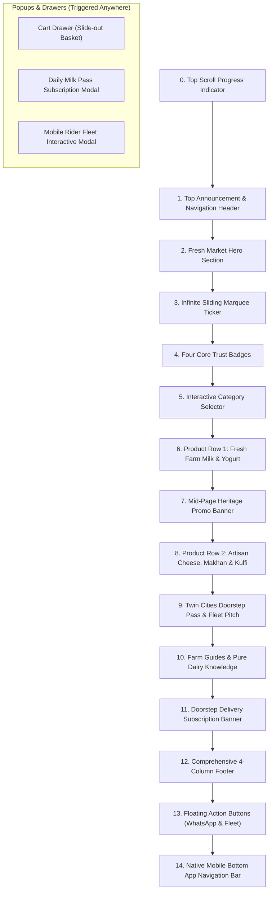

# Heaven's Dairy — Comprehensive Section-by-Section Developer & Non-Tech Guide

*A complete, granular manual explaining exactly what happens in every single section of the Heaven's Dairy web application, how user interactions are processed, and where each feature is located.*

---

## 1. High-Level Architecture & Page Flow

When a user visits **Heaven's Dairy**, the entire application is orchestrated by [`src/App.jsx`](file:///e:/Heaven-s-Dairy/src/App.jsx). 

The application renders in the following sequential order:



---

## 2. In-Depth Section-by-Section Walkthrough

---

### Section 0: Top Scroll Progress Indicator
- **File:** Handled directly in [`src/App.jsx`](file:///e:/Heaven-s-Dairy/src/App.jsx#L120-L123)
- **What is happening here:**
  - A subtle 4px progress line fixed at the very top of the screen (`z-50`).
  - As the user scrolls down through the products and stories, a JavaScript scroll listener calculates the percentage of the page viewed `(scrollY / totalHeight) * 100`.
  - The bar expands from 0% to 100% with a gradient from emerald green through golden amber to lime green.
- **User Impact:** Gives users a smooth visual indicator of their journey through the store.

---

### Section 1: Navigation Header
- **File:** [`src/components/OrganicoHeader.jsx`](file:///e:/Heaven-s-Dairy/src/components/OrganicoHeader.jsx)
- **What is happening here:**
  1. **Top Mini Bar:** Displays the store schedule (*"Daily Milk Dispatch: 6:00 AM – 8:00 AM"*), coverage areas (*Soan Gardens, PWD, Media Town, Bahria Town*), and a direct phone link (`0335 9131316`).
  2. **Main Brand Bar:**
     - **Logo & Name:** Displays "Heaven's Dairy" (Doodh Ghar) with an organic cow icon badge. Clicking resets the view to home.
     - **Category Selector Dropdown:** Allows rapid jumping between Milk, Dahi, Butter, and Cheese.
     - **Live Search Bar:** Customers can type item names (e.g., "Cow", "Makhan", "Paneer"). As they type, it filters products instantly.
     - **Daily Pass Shortcut:** A highlighted golden button opening the Milk Subscription dialog.
     - **Shopping Basket Button:** Shows a shopping bag icon with a badge showing total items in the basket (e.g., `2`) and the current monetary total (e.g., `Rs. 480`).
  3. **Mobile Drawer Toggle:** On mobile screens, hamburger menus expand full-screen category links and contact shortcuts.
- **When Clicked:**
  - Clicking the **Cart Icon** triggers `onOpenCart()` → Opens `CartDrawer`.
  - Clicking **Daily Pass** triggers `onOpenSubscribe()` → Opens `SubscriptionModal`.
  - Clicking **Rider App** triggers `onOpenRiderApp()` → Opens `RiderAppModal`.

---

### Section 2: Fresh Market Hero Section
- **File:** [`src/components/OrganicoHero.jsx`](file:///e:/Heaven-s-Dairy/src/components/OrganicoHero.jsx)
- **What is happening here:**
  - The hero is the visual centerpiece that creates immediate buying confidence.
  - **Left Column (Value Proposition):**
    - High-visibility pill: *"Twin Cities Farm-to-Doorstep Guarantee"*.
    - Bold headline: *"100% Raw Chilled Milk & Artisanal Dairy Delivered Daily Before 8:00 AM"*.
    - Supporting description highlighting water-free testing and cold-chain transport chilled to 4°C within 15 minutes of dawn milking.
    - **Primary CTA Buttons:**
      - **"Order Fresh Basket" (Emerald Button):** Opens the Cart Drawer for one-time purchases.
      - **"Start Morning Milk Pass" (Amber Button):** Opens the Daily Subscription Modal.
      - **"Explore Fleet Tech" (Subtle Link):** Opens the Rider App Modal.
  - **Right Column (Hero Imagery & Floating Trust Badges):**
    - High-definition image of fresh glass-bottled dairy.
    - Two floating dynamic glass cards:
      - *Card 1:* "Chilled at 4°C — Zero Warm Transit".
      - *Card 2:* "Morning 6:00 AM Slot — Soan Gardens, PWD & Bahria".

---

### Section 3: Infinite Sliding Marquee Ticker
- **File:** [`src/components/SlidingTicker.jsx`](file:///e:/Heaven-s-Dairy/src/components/SlidingTicker.jsx)
- **What is happening here:**
  - A continuous, seamless looping ticker moving across the screen horizontally.
  - Repeats key slogans separated by star icons:
    *✦ 100% Water-Free Tested ✦ Chilled to 4°C within 15 Mins ✦ Delivered Before 8:00 AM ✦ Clay Pot Set Matka Dahi ✦ Pure Valoda Desi Ghee ✦ Zero Hormones or Preservatives*.
  - Pauses or slows smoothly on mouse hover so customers can read comfortably.

---

### Section 4: Four Core Trust Badges
- **File:** [`src/components/TrustBadges.jsx`](file:///e:/Heaven-s-Dairy/src/components/TrustBadges.jsx)
- **What is happening here:**
  - Positioned directly beneath the ticker to eliminate customer hesitation regarding dairy authenticity.
  - Arranged in a responsive 4-column desktop / 2-column mobile grid:
    1. **Zero Adulteration:** 100% pure milk verified by daily lactometer and solid-non-fat (SNF) laboratory checks.
    2. **Cold-Chain Transport:** Bottled and kept under 4°C in insulated containers right to the customer's gate.
    3. **Clay Pot Cultured:** Traditional red clay matkas absorb excess moisture, creating thick, sweet curd naturally without gelatin.
    4. **Flexible Passes:** Pause deliveries whenever traveling with 1-tap WhatsApp notifications.

---

### Section 5: Interactive Category Selector
- **File:** [`src/components/CategoriesSection.jsx`](file:///e:/Heaven-s-Dairy/src/components/CategoriesSection.jsx)
- **What is happening here:**
  - A horizontal filter ribbon containing category pills:
    - *All Categories*
    - *Fresh Milk* (Bhains & Cow milk, Farm Malai)
    - *Traditional Yogurt* (Matka Dahi, Desi Lassi)
    - *Desi Butter & Ghee* (Hand-churned Makhan & Khalis Ghee)
    - *Artisan Cheese* (Fresh Paneer, Herb & Cumin Paneer)
    - *Shahi Kulfi & Treats* (Khoya Kulfi, Pure Mawa)
- **Interactive Behavior:**
  - When a customer clicks a category (e.g., *"Artisan Cheese"*):
    - In [`src/App.jsx`](file:///e:/Heaven-s-Dairy/src/App.jsx#L112-L115), state `selectedCategory` changes.
    - Instead of showing two default rows, the page switches into focused category mode displaying only matching cheese items.
    - Clicking *"All"* returns the store to full catalog view.

---

### Section 6: Product Row 1 (Fresh Farm Milk & Yogurt)
- **File:** [`src/components/DairyProductRow.jsx`](file:///e:/Heaven-s-Dairy/src/components/DairyProductRow.jsx)
- **What is happening here:**
  - Displays the first 5 core staples: **Pure Buffalo Milk (Rs. 240/L)**, **Pure A2 Cow Milk (Rs. 260/L)**, **Traditional Matka Dahi (Rs. 320/Kg)**, **Desi Sweet Lassi (Rs. 180)**, and **Farm Malai (Rs. 380)**.
  - **Inside Each Product Card:**
    - Product photo with smooth zoom on hover.
    - Purity / Fat badge (e.g., *"6.5% - 7.5% Natural Fat"* or *"Probiotic Rich"*).
    - Unit price and package size.
    - **"Add to Basket" Button:** Adds 1 item to the global cart and displays a bouncing green toast notification at the bottom: *"Added Pure Buffalo Milk to basket!"*.
    - **"Daily Pass" Button:** Rendered on milk products. Clicking opens the subscription modal with that specific milk pre-selected.

---

### Section 7: Mid-Page Heritage Promo Banner
- **File:** [`src/components/AboutPromoBanner.jsx`](file:///e:/Heaven-s-Dairy/src/components/AboutPromoBanner.jsx)
- **What is happening here:**
  - A visual storytelling break halfway down the page celebrating traditional dairy-making heritage.
  - Highlights traditional hand-churning (*Bilona/Valoda*) over industrial factory processing.
  - Showcases golden desi butter and slow-simmered ghee.
  - Features an instant button: *"Start Daily Delivery Routine"* which launches the subscription setup.

---

### Section 8: Product Row 2 (Artisan Cheese, Desi Makhan & Treats)
- **File:** [`src/components/DairyProductRow.jsx`](file:///e:/Heaven-s-Dairy/src/components/DairyProductRow.jsx)
- **What is happening here:**
  - Displays the artisanal line: **Hand-Churned Desi Butter (Rs. 650)**, **Artisan Fresh Malai Paneer (Rs. 420)**, **Shahi Khoya Kulfi (Rs. 180)**, **Pure Organic Khoya (Rs. 480)**, and **Artisan Herb & Cumin Paneer (Rs. 450)**.
  - Same interaction: customers can inspect ingredients, add to cart, and adjust quantities directly.

---

### Section 9: Morning Milk Pass & Rider App Tech Pitch
- **File:** [`src/components/PitchSection.jsx`](file:///e:/Heaven-s-Dairy/src/components/PitchSection.jsx)
- **What is happening here:**
  - A dual-column powerhouse that drives both customer subscriptions and brand technical authority.
  - **Left Side — Live Milk Pass Cost Calculator:**
    - Dropdowns to select:
      1. Delivery Sector (*Soan Gardens, PWD, Media Town, Bahria Town, Police Foundation*).
      2. Milk Variety (*Buffalo Milk @ Rs. 240/L* vs. *A2 Cow Milk @ Rs. 260/L*).
      3. Daily Volume (*1L, 2L, 3L, 4L, 5L*).
      4. Schedule (*Daily = 30 days*, *Alternate Days = 15 days*, *Weekdays = 22 days*).
      5. Delivery Slot (*Sunrise 6:00 AM - 8:00 AM* or *Evening 5:00 PM - 7:30 PM*).
    - **Live Dynamic Math:** As the user tweaks any selector, the monthly estimation updates automatically in real-time (`litres * price * days`).
    - **1-Tap WhatsApp Activation:** Clicking *"Activate Morning Pass via WhatsApp"* opens WhatsApp with the exact configuration pre-written.
  - **Right Side — Rider App Fleet Innovation Showcase:**
    - Demonstrates Heaven's Dairy's logistics platform.
    - Highlights delivery tracking, doorstep photo confirmations, insulated thermal bags, and automated sunrise routing.
    - Contains a *"Launch Fleet Interactive Demo"* button opening `RiderAppModal`.

---

### Section 10: Farm Guides & Pure Dairy Knowledge
- **File:** [`src/components/FarmGuidesSection.jsx`](file:///e:/Heaven-s-Dairy/src/components/FarmGuidesSection.jsx)
- **What is happening here:**
  - 3 educational articles written to educate consumers and position Heaven's Dairy as an industry authority:
    1. *"The A2 Protein Difference: Why Cow Milk is Gentler on Sensitive Stomachs"*.
    2. *"Why Matka Dahi Outperforms Factory Plastic Tubs"*.
    3. *"How to Test Milk Purity at Home with 3 Simple Checks"*.
  - Increases time spent on page and boosts buyer confidence.

---

### Section 11: Doorstep Delivery Subscription Banner
- **File:** [`src/components/DeliverySubscriptionBanner.jsx`](file:///e:/Heaven-s-Dairy/src/components/DeliverySubscriptionBanner.jsx)
- **What is happening here:**
  - A high-contrast conversion banner located near the end of the page.
  - Headline: *"Never Wake Up Without Fresh Milk Again"*.
  - Emphasizes doorstep delivery before 7:30 AM across Twin Cities sectors with zero advance commitment.
  - Includes a direct button triggering `SubscriptionModal`.

---

### Section 12: Comprehensive 4-Column Footer
- **File:** [`src/components/OrganicoFooter.jsx`](file:///e:/Heaven-s-Dairy/src/components/OrganicoFooter.jsx)
- **What is happening here:**
  - **Column 1 (Brand & Philosophy):** Story of Heaven's Dairy (Doodh Ghar), hygienic milking practices, cold storage standards.
  - **Column 2 (Covered Twin Cities Routes):** Exact delivery timings for Soan Gardens Phase 1 & 2, PWD Housing Society, Media Town, Bahria Town (Phases 1-8), and CBR/Police Foundation.
  - **Column 3 (Direct Store Information):**
    - Address: *Soan Gardens Phase 2, Islamabad*.
    - Phone: `+92 335 9131316`.
    - Direct link to open location on **Yandex Maps / Google Maps**.
    - Morning and Evening store operating hours.
    - Direct WhatsApp chat link.
  - **Column 4 (Guarantees & Fleet System):** Links to launch the Milk Pass calculator and Rider App proposal.
  - **Bottom Bar:** Copyright notice and payment methods accepted (Cash on Delivery, Bank Transfer, EasyPaisa, JazzCash).

---

### Section 13: Floating Action Buttons (Persistent Controls)
- **File:** Located in [`src/App.jsx`](file:///e:/Heaven-s-Dairy/src/App.jsx#L253-L272)
- **What is happening here:**
  - Floating in the bottom-right corner of the browser window regardless of scroll position:
    1. **Desktop Rider App Button:** Clicking launches the Rider Fleet prototype dialog.
    2. **WhatsApp Pulse Button (Green Bubble):** A pulsing green WhatsApp button. Clicking immediately opens a WhatsApp conversation with Heaven's Dairy customer service (`+92 335 9131316`) pre-filled with *"Hello Heaven's Dairy! I want to order farm-fresh milk."*

---

### Section 14: Native Mobile Bottom Navigation Bar
- **File:** Located in [`src/App.jsx`](file:///e:/Heaven-s-Dairy/src/App.jsx#L274-L325)
- **What is happening here:**
  - On desktop screens, this bar is hidden (`hidden md:flex`).
  - On smartphone screens (`< 768px`), it sticks to the bottom edge, providing an intuitive mobile-app feel:
    - **Home Tab:** Jumps to the top of the store.
    - **Products Tab:** Scrolls down to the catalog cards.
    - **Daily Pass Tab (Elevated Center Button):** A raised dark-green button with a golden star that opens the milk subscription modal.
    - **Rider App Tab:** Opens the fleet demonstration modal.
    - **Cart Tab:** Displays a shopping bag icon with a red/amber circular counter indicating total items in the basket. Clicking opens `CartDrawer`.

---

## 3. Popups & Interactive Modals (The Logic Layer)

### 1. Cart Drawer (Shopping Basket)
- **File:** [`src/components/CartDrawer.jsx`](file:///e:/Heaven-s-Dairy/src/components/CartDrawer.jsx)
- **What is happening here:**
  - Slides in smoothly from the right side over a frosted glass backdrop.
  - **Item Controls:** For each item added, the customer can click `+` to increase, `-` to decrease, or the trash icon to remove.
  - **Free Delivery Calculation:**
    ```javascript
    const deliveryFee = subtotal >= 500 ? 0 : 100;
    const grandTotal = subtotal + deliveryFee;
    ```
    If the customer's subtotal reaches **Rs. 500**, delivery switches to **FREE**. If under Rs. 500, a **Rs. 100** delivery fee is added.
  - **WhatsApp Order Compilation:**
    When the customer clicks *"Order via WhatsApp"*, the component loops through every item and builds a structured text message:
    ```
    *New Dairy Order - Heaven's Dairy*
    • 2x Pure Buffalo Milk (Rs. 480)
    • 1x Traditional Matka Dahi (Rs. 320)

    • Subtotal: Rs. 800
    • Delivery Fee: FREE
    • Grand Total: Rs. 800

    Please deliver to my address in Islamabad.
    ```
    It immediately redirects to `https://wa.me/923359131316` with the pre-filled text.

---

### 2. Subscription Modal (Daily Milk Pass)
- **File:** [`src/components/SubscriptionModal.jsx`](file:///e:/Heaven-s-Dairy/src/components/SubscriptionModal.jsx)
- **What is happening here:**
  - Pops up in the center of the screen when any *"Subscribe"* or *"Daily Pass"* button is clicked.
  - **Form Fields:**
    - Customer Name & Contact Phone.
    - Sector Selection (Dropdown of all supported twin cities areas).
    - Exact House Address & Landmarks.
    - Milk Selection (Buffalo @ Rs. 240/L vs. Cow @ Rs. 260/L).
    - Litres required per day (1, 2, 3, 4, 5+).
    - Delivery Frequency: *Daily (30 days)*, *Alternate Days (15 days)*, or *Weekdays only (22 days)*.
    - Preferred Slot: *Sunrise (6:00 AM – 8:00 AM)* or *Evening (5:00 PM – 7:30 PM)*.
    - Special delivery instructions (e.g., *"Please leave in porch cooler box"*).
  - **Monthly Bill Computation:**
    Calculates `litres * pricePerLitre * daysInMonth` and presents the estimated monthly budget.
  - **WhatsApp Submission:**
    Formats the complete profile into a structured subscription contract and launches WhatsApp to finalize the schedule with the dispatcher.

---

### 3. Rider App Modal (Fleet Management Showcase)
- **File:** [`src/components/RiderAppModal.jsx`](file:///e:/Heaven-s-Dairy/src/components/RiderAppModal.jsx)
- **What is happening here:**
  - A showcase dialog explaining Heaven's Dairy's modern delivery architecture.
  - Contains 3 interactive tabs:
    1. **Interactive Rider App Prototype:** Shows a simulated mobile smartphone screen displaying real rider stops (Brig. Tariq, Farah Zafar, Dr. Rizwan, Hamza Malik). Users can click *"Mark Delivered"* to watch the stop status change in real-time.
    2. **Fleet Architecture:** Explains the cold-chain telemetry, route grouping by sector, and automated customer SMS/WhatsApp arrival alerts.
    3. **Business ROI:** Shows savings in transit fuel, zero sour milk waste, and customer retention metrics.

---

## 4. The Single File You Need to Know: `src/data/dairyData.js`

For non-technical owners and store managers, you almost never need to touch React code. **Every product, price, and store setting is gathered inside [`src/data/dairyData.js`](file:///e:/Heaven-s-Dairy/src/data/dairyData.js).**

```
┌────────────────────────────────────────────────────────┐
│               src/data/dairyData.js                    │
├──────────────────────────┬─────────────────────────────┤
│ 1. STORE_INFO            │ 2. PRODUCTS LIST            │
│  • Store Name            │  • Product ID & Title       │
│  • Phone & WhatsApp #    │  • Price & Unit (per Litre) │
│  • Delivery Areas & Time │  • Fat Content & Tags       │
│  • Rating & Map URL      │  • Images & Descriptions    │
└──────────────────────────┴─────────────────────────────┘
```

### How to update any data (Step-by-Step):

| I want to change... | Where to look in `dairyData.js` | What to change |
| :--- | :--- | :--- |
| **A product price** | Under `PRODUCTS`, find product `id` | Update `price: 240` to your new price |
| **WhatsApp number** | Under `STORE_INFO` | Change `whatsapp: "923359131316"` |
| **Phone number displayed** | Under `STORE_INFO` | Change `phoneDisplay: "0335 9131316"` |
| **Add a new delivery sector** | Under `STORE_INFO.deliveryAreas` | Add `{ name: "New Sector", time: "6:30 AM - 8:00 AM", freeOver: 500 }` |
| **Change product image** | Under `PRODUCTS` | Update the `image: "https://..."` URL |

---

## 5. How to Run & Build

1. **To run the website on your computer:**
   ```powershell
   npm run dev
   ```
   Open `http://localhost:5173` in any browser.
2. **To compile for live hosting (Vercel, Netlify, cPanel):**
   ```powershell
   npm run build
   ```
   This generates the production-ready `dist` folder.
